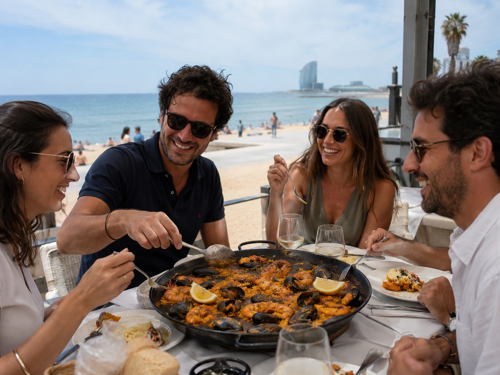

import ListingBlock from '../../components/elements/listing-block.astro';
import MapBlock from '../../components/elements/map.astro';
import Data from '../../data/paella.ts';

## Contents

## Paella restaurants in Barceloneta
A lot of the restaurants below have outdoor seating, but it can depend on the time of day and time of year as to whether their terrace is in operation.

<MapBlock items={Data} center={{lat: 41.37845697397939, lng: 2.190214034698129, zoom: 13}} />

